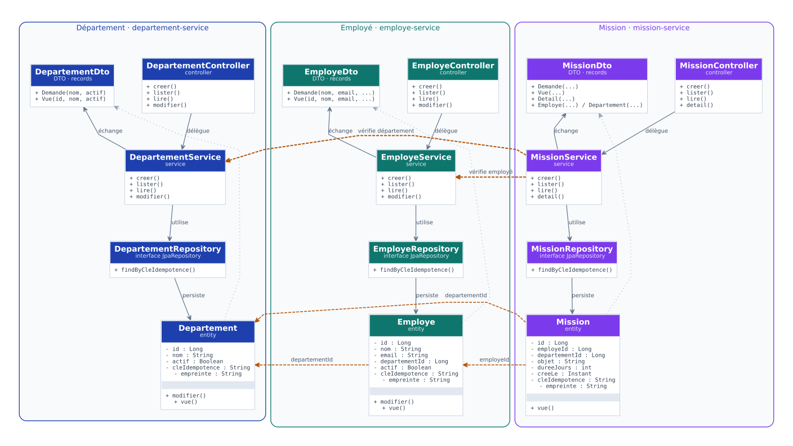
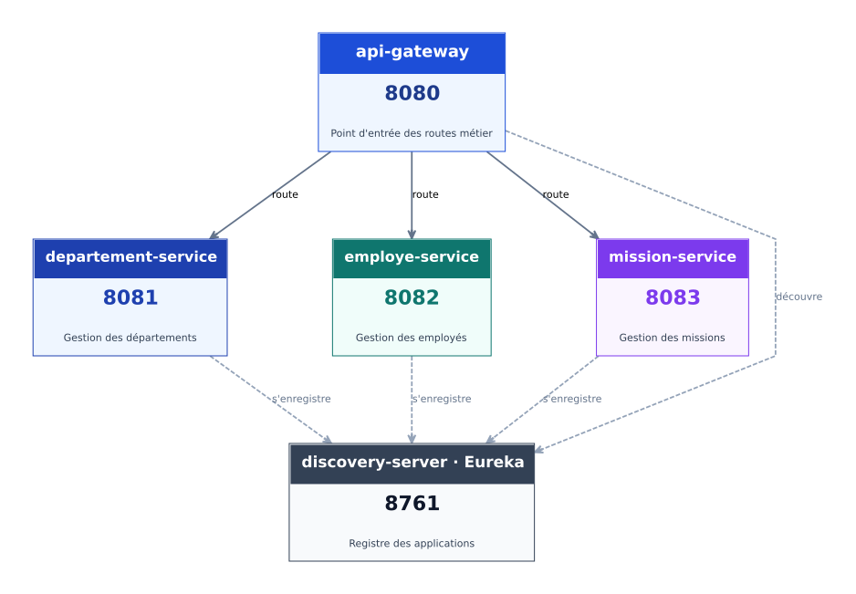

# Gestion d’entreprise — Projet JEE et microservices

Un jalon initial de conception et six états complets d’une même application. Ouvrez le `pom.xml` du jalon exécutable choisi dans IntelliJ IDEA.
Chaque dossier se compile et se lance séparément. Les ports sont réutilisés d’un jalon à l’autre.

| Dossier | Évolution principale |
|---|---|
| [jalon_init](jalon_init/README.md) | Description du projet, UML de classes et architecture à cinq applications |
| [jalon_1](jalon_1/README.md) | Départements, employés, missions et données séparées |
| [jalon_2](jalon_2/README.md) | Eureka et routes dynamiques de la Gateway |
| [jalon_3](jalon_3/README.md) | Spring Cloud Config et dépôt Git de configuration |
| [jalon_4](jalon_4/README.md) | OpenFeign, validation métier, détail et rejeu de mission |
| [jalon_5](jalon_5/README.md) | Outbox transactionnelle, RabbitMQ, courriels et traitement différé |
| [jalon_6](jalon_6/README.md) | Résilience sur deux appels Feign et idempotence de tous les POST |

Les collections Postman, les résultats observés, les diagrammes et les étapes de démarrage sont dans
chaque dossier. Pour évaluer l’ensemble du projet sur une seule version, ouvrez `jalon_6`.

## Jalon init — conception globale

Le projet organise la gestion des **départements**, des **employés** et des **missions** en trois services métier indépendants. Une **API Gateway** (port **8080**) achemine les requêtes ; **Eureka** (port **8761**) assure la découverte des services. Les trois services métier utilisent respectivement les ports **8081**, **8082** et **8083**.

### Diagramme de classes UML

### Architecture des cinq applications

Le [README du jalon init](jalon_init/README.md) documente les relations entre classes et contient les schémas en **SVG**, **PNG** et leurs sources **DOT** modifiables. Le schéma porte sur les cinq applications demandées ; les composants supplémentaires introduits après le jalon 2 n'y figurent pas.

## Historique Git collectif

Ce dépôt est alimenté progressivement par cinq contributeurs avec **sept commits** :

1. `jalon_init` — personne 1
2. `jalon_1` — personne 1
3. `jalon_2` — personne 2
4. `jalon_3` — personne 2
5. `jalon_4` — personne 3
6. `jalon_5` — personne 4
7. `jalon_6` — personne 5

Chaque membre ajoute uniquement le dossier de son jalon au commit correspondant.
Pour les jalons 3 à 6, le dossier `config-repo` est versionné dans le dépôt collectif **sans son propre dossier `.git`**.
Pour exécuter ces jalons avec Spring Cloud Config, initialisez un dépôt Git local dans ce dossier
en suivant les commandes du README de chaque jalon. Cette initialisation locale ne doit pas être ajoutée au dépôt collectif.

**Socle** — Java 17, Maven, Spring Boot 3.5.6 et Spring Cloud 2025.0.0, conformément au TP.

## Résultats de vérification

Les six projets ont été compilés avec `mvn clean verify` sous OpenJDK 17. Les journaux JSON
contiennent les requêtes et réponses HTTP observées. La colonne Postman compte les assertions
du dossier 01 exécutées via Newman.

| Jalon | Requêtes et contrôles HTTP archivés | Assertions Postman |
|---|---:|---:|
| 1 | 11 | 23 |
| 2 | 12 | 23 |
| 3 | 13 | 28 |
| 4 | 23 | 50 |
| 5 | 31 | 50 |
| 6 | 50 | 60 |

Les essais de messagerie ont utilisé RabbitMQ 4.0.5 et Mailpit 1.27.4 en processus locaux.
Les deux fichiers Compose ont été validés avec `docker compose config`. Ils utilisent
les images RabbitMQ 4.2 et Mailpit 1.27.4 pour reproduire la démonstration.
