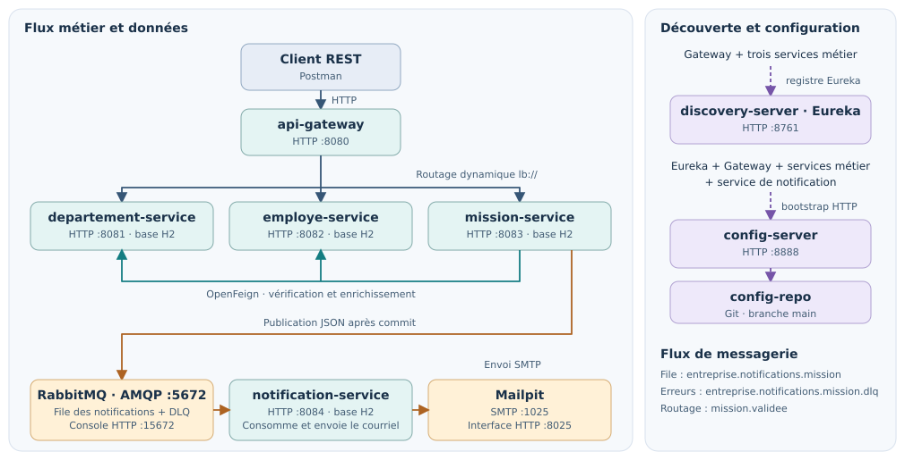

# Gestion d’entreprise · Jalon 5.0

**RabbitMQ et courriels** — Un événement JSON déclenche l’envoi différé d’un courriel dans Mailpit.

Le domaine couvre les départements, les employés et les missions internes. Chaque application Spring Boot
est un module Maven importable dans IntelliJ IDEA. Les modules `api-commun` et, à partir du jalon 5,
`notification-contrat` sont des bibliothèques partagées.



## Prérequis et démarrage

Installez un **JDK 17** et **Maven 3.9** ainsi que **Git** et **Docker Desktop avec Compose v2**.
Ouvrez le `pom.xml` de `jalon_5` dans IntelliJ IDEA en tant que projet Maven. Sélectionnez le JDK 17
dans **Project Structure** et dans les réglages Maven d’IntelliJ. Chargez les modules.

## Infrastructure du jalon

Dans le dossier du jalon, démarrez Docker Desktop et exécutez :

```powershell
docker compose up -d
docker compose ps
```

| Composant | Accès local |
|---|---|
| RabbitMQ AMQP | `localhost:5672` |
| Console RabbitMQ | [localhost:15672](http://localhost:15672) |
| SMTP Mailpit | `localhost:1025` |
| Boîte Mailpit | [localhost:8025](http://localhost:8025) |

Le compte de démonstration RabbitMQ est `entreprise` avec le mot de passe `entreprise-dev`. Les variables
`RABBITMQ_USER` et `RABBITMQ_PASSWORD` doivent être identiques dans le terminal Compose et les applications.
Elles initialisent le compte à la première création du volume. Les propriétés RabbitMQ et SMTP sont dans `config-repo`.
Pour arrêter l’infrastructure en conservant le volume, utilisez `docker compose down`.


### Démarrage par terminal

Placez-vous dans `jalon_5` et compilez :

```powershell
mvn clean verify
```

Lancez **une commande par terminal**, toujours depuis la racine de ce jalon et dans l’ordre indiqué.
Attendez que l’application précédente ait démarré. Arrêtez les applications d’un autre jalon avant de démarrer celui-ci.

```powershell
java -jar ./config-server/target/config-server-5.0.0.jar
java -jar ./discovery-server/target/discovery-server-5.0.0.jar
java -jar ./departement-service/target/departement-service-5.0.0.jar
java -jar ./employe-service/target/employe-service-5.0.0.jar
java -jar ./mission-service/target/mission-service-5.0.0.jar
java -jar ./api-gateway/target/api-gateway-5.0.0.jar
java -jar ./notification-service/target/notification-service-5.0.0.jar
```

Depuis IntelliJ, lancez les classes suivantes dans le même ordre. Dans **Run → Edit Configurations**,
choisissez comme répertoire de travail la racine de `jalon_5`.

| Module | Port HTTP | Classe principale |
|---|---:|---|
| `config-server` | 8888 | `ConfigApplication` |
| `discovery-server` | 8761 | `DiscoveryApplication` |
| `departement-service` | 8081 | `DepartementApplication` |
| `employe-service` | 8082 | `EmployeApplication` |
| `mission-service` | 8083 | `MissionApplication` |
| `api-gateway` | 8080 | `GatewayApplication` |
| `notification-service` | 8084 | `NotificationApplication` |

Chaque application expose `/actuator/health` sur son port. La base H2 de chaque service se trouve dans
son propre fichier sous `data/`. Le dossier est créé au démarrage. Le chemin peut être modifié via
`ENTREPRISE_DATA_DIR`. Gardez un dossier de données distinct par jalon.


Le tableau de bord [Eureka](http://localhost:8761) doit afficher `DEPARTEMENT-SERVICE`,
`EMPLOYE-SERVICE`, `MISSION-SERVICE` et `API-GATEWAY`. Attendez leur enregistrement et quelques
secondes de rafraîchissement avant les premiers appels. La Gateway construit les routes en découvrant
les trois services métier. Une URL de la forme `/mission-service/missions` est relayée vers `/missions`
sur une instance découverte de `mission-service`.


## Config Server et dépôt Git

`config-repo/application.properties` fournit les valeurs communes. Chaque `<service>.properties` définit
les valeurs propres au service. Les fichiers locaux des clients contiennent leur nom et l’adresse de bootstrap du Config Server.
`config-server` garde sa propre configuration de démarrage.

```powershell
git -C config-repo log -1 --oneline
Invoke-RestMethod http://localhost:8888/mission-service/default/main | ConvertTo-Json -Depth 10
```

La réponse contient deux `propertySources`. Le fichier de `mission-service` donne `server.port=8083`
et le fichier global donne `info.projet=Gestion d'entreprise`. La valeur `version` est le SHA du commit chargé.

Pour modifier une valeur, éditez le fichier, faites un commit sur `main`, vérifiez l’endpoint Config Server
puis redémarrez le client concerné. En cas de chemin personnalisé, définissez `CONFIG_REPO_URI` avant de démarrer
le Config Server, par exemple `file:///C:/projets/gestion/config-repo`. Une URL Git distante fonctionne aussi
si elle est joignable et possède une branche `main`.

Si vous démarrez depuis un clone du bundle principal, initialisez d’abord ce dépôt séparé dans la version extraite :

```powershell
git -C config-repo init -b main
git -C config-repo add .
git -C config-repo -c user.name="Etudiant" -c user.email="etudiant@example.test" commit -m "Configuration initiale"
```

## API REST

| Ressource | URL de base |
|---|---|
| `/departements` | `http://localhost:8080/departement-service/departements` |
| `/employes` | `http://localhost:8080/employe-service/employes` |
| `/missions` | `http://localhost:8080/mission-service/missions` |

- `GET` sur l’URL de base liste les ressources. `GET /{id}` lit une ressource.
- `POST` crée une ressource et retourne `201 Created` avec un en-tête `Location`.
- `PUT /{id}` remplace les données d’un employé ou d’un département. Le statut `actif` permet de le désactiver.
- Un DTO invalide retourne `400`. Un identifiant absent retourne `404`.
- Un nom de département ou un email d’employé déjà utilisé retourne `409`.

| Données initiales | ID | Valeur |
|---|---:|---|
| Département | 1 | Informatique, actif |
| Département | 2 | Archives, inactif |
| Département | 3 | Finance, actif |
| Employé | 1 | Sara Amrani, Informatique, active |
| Employé | 2 | Youssef Naji, Informatique, inactif |
| Employé | 3 | Lina El Idrissi, Archives, active |
| Employé | 4 | Adam Karim, Finance, actif |

Ces données sont initialisées dans les bases vides. Pour un essai rapide sous PowerShell :

```powershell
$mission = @{ employeId=1; departementId=1; objet="Audit réseau"; dureeJours=3 } | ConvertTo-Json
$reponse = Invoke-WebRequest -Method Post -Uri "http://localhost:8080/mission-service/missions" -ContentType "application/json" -Headers @{ "Idempotency-Key"="mission-audit-001" } -Body $mission
$reponse.StatusCode
$reponse.Content
```


## Règles de validation d’une mission

- L’employé et le département doivent exister et être actifs.
- L’employé doit appartenir au département fourni.
- La durée autorisée est de 1 à 30 jours. Une validation réussie crée une mission au statut `VALIDEE`.
- Le détail `GET /missions/{id}/detail` regroupe la mission et les deux réponses Feign. La lecture
  `GET /missions/{id}` consulte uniquement la base locale.

Les références absentes produisent `404`, les refus métier `400` et l’indisponibilité d’une dépendance `503`.
Une réponse distante inattendue produit `502`. Les erreurs REST utilisent `application/problem+json`
avec un champ `code` et, pour les DTO invalides, un objet `errors` par champ.

### Clé d’idempotence

`POST /missions` exige l’en-tête `Idempotency-Key`.
Il accepte 1 à 100 caractères parmi les lettres ASCII, les chiffres et `._-`. Utilisez une nouvelle clé
par demande. Un même corps et une même clé donnent `201` à la première création, puis `200` avec le même
identifiant et `Idempotency-Replayed: true`. Un corps différent avec cette clé donne `409`.
La clé et l’empreinte du DTO validé sont conservées en base avec la ressource. Une contrainte unique
départage deux créations concurrentes. Un échec de validation ou de dépendance laisse la clé disponible.
Le rejeu d’une mission déjà créée se résout localement, même pendant une panne Feign.


## Notification asynchrone

1. Mission et événement JSON sont écrits ensemble dans la base de `mission-service`.
2. Après le commit, le relais lit l’outbox et publie sur l’exchange direct `entreprise.missions`
   avec la clé de routage `mission.validee`. Une confirmation du broker marque l’événement comme publié.
3. RabbitMQ conserve les messages persistants dans `entreprise.notifications.mission`.
4. `notification-service` consomme le message, transmet le courriel à Mailpit et mémorise l’identifiant
   d’événement avant l’acquittement. Une redélivrance d’un événement déjà marqué est ignorée.

Si le broker tombe, le relais reprogramme l’événement. Si le consommateur est arrêté, RabbitMQ conserve
la file. Pour une erreur SMTP, le consommateur effectue jusqu’à trois tentatives avant la file d’erreurs
`entreprise.notifications.mission.dlq`. La création HTTP peut donc réussir alors que l’envoi est différé.

La livraison est au moins une fois. Une panne entre l’acceptation du courriel par SMTP et le commit de
la trace de consommation peut exceptionnellement provoquer un second courriel.

## Vérification avec Postman

1. Importez [Gestion-Entreprise-J5.postman_collection.json](tests/Gestion-Entreprise-J5.postman_collection.json).
2. Lancez le dossier **01 — Parcours normal et erreurs** dans le Collection Runner, avec une itération.
   La première requête génère le suffixe d’exécution et les créations enregistrent leurs identifiants dans la collection.
3. Pour les cas qui nécessitent un arrêt de service, suivez le [guide de démonstration](tests/DEMONSTRATION.md).
4. Les exemples **Réponse observée** et le [journal des vérifications](tests/resultats-observes.json)
   donnent les requêtes et réponses capturées pendant les essais.

Référence du cours : [tp-ms-ecom · V5.0](https://github.com/salimk/tp-ms-ecom/tree/V5.0).
