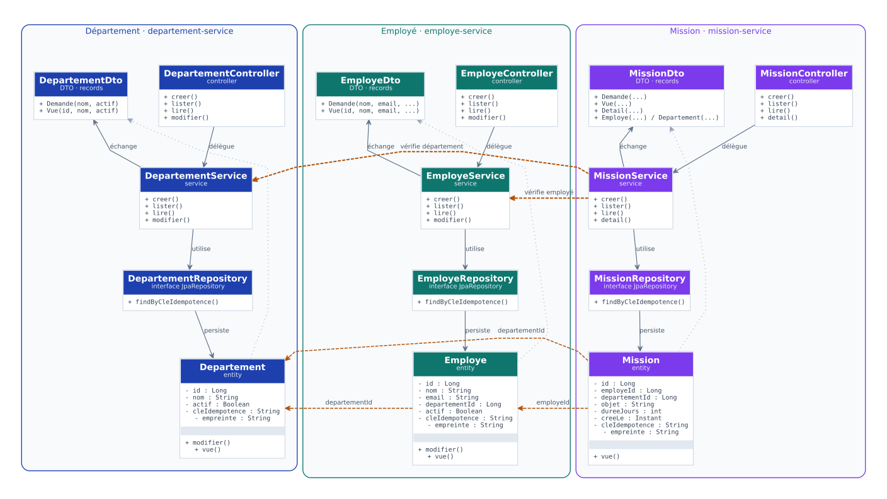
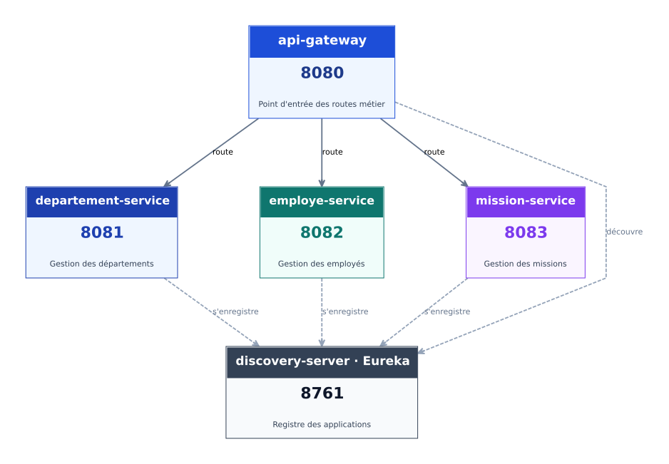

# Gestion d’entreprise — Jalon init

## Description du projet

Application de gestion d'entreprise organisée en **trois microservices métier** : gestion des départements, gestion des employés et gestion des missions. Chaque service possède ses données et expose les opérations nécessaires à son domaine. Une **API Gateway** centralise l'accès aux services, tandis qu'un **serveur Eureka** permet leur découverte.

## Diagramme de classes UML global



Le diagramme présente les classes principales de chaque service métier : **entité, DTO, contrôleur, service et repository**. Les relations à l'intérieur d'un service représentent l'utilisation des couches. Les **flèches de dépendance en pointillés** indiquent les interactions logiques entre les services, sans imposer un protocole de communication.

- **Employé → Département** : l'attribut `departementId` référence l'identifiant d'un département.
- **Mission → Employé / Département** : les attributs `employeId` et `departementId` identifient les ressources concernées.
- **MissionService → EmployeService / DepartementService** : dépendances métier nécessaires pour contrôler l'existence, l'état et l'affectation des ressources. La validation effective apparaît à partir du **jalon 4**.

Ces relations interservices sont **logiques** : les entités ne sont ni partagées entre bases de données ni reliées par des clés étrangères interservices. Les diagrammes sont basés sur les classes du code des jalons et présentent leur structure commune, y compris les attributs ajoutés au fil des versions.

## Architecture — cinq applications



| Application | Rôle | Port HTTP |
|---|---|---:|
| `api-gateway` | Point d'entrée et routage | **8080** |
| `departement-service` | Gestion des départements | **8081** |
| `employe-service` | Gestion des employés | **8082** |
| `mission-service` | Gestion des missions | **8083** |
| `discovery-server` (Eureka) | Registre et découverte | **8761** |

Cette architecture correspond au périmètre **des cinq applications demandé pour le jalon init**. Elle devient exécutable à partir du **jalon 2** : le jalon 1 fournit d'abord les trois services métier indépendants. Les jalons suivants introduisent d'autres composants, notamment Config Server et Notification Service, qui ne figurent pas dans ce schéma initial volontairement limité à cinq applications.

## Diagrammes modifiables

| Diagramme | Source modifiable | Vectoriel | Image |
|---|---|---|---|
| Classes UML global | [Graphviz DOT](docs/diagramme_classes_global.dot) | [SVG](docs/diagramme_classes_global.svg) | [PNG](docs/diagramme_classes_global.png) |
| Architecture des cinq applications | [Graphviz DOT](docs/architecture_5_applications.dot) | [SVG](docs/architecture_5_applications.svg) | [PNG](docs/architecture_5_applications.png) |

Pour régénérer les illustrations, avec Graphviz installé :

```bash
dot -Tsvg docs/diagramme_classes_global.dot -o docs/diagramme_classes_global.svg
dot -Tsvg docs/architecture_5_applications.dot -o docs/architecture_5_applications.svg
```

**Jalon init : documentation de conception.** Aucune application Java supplémentaire à lancer dans ce dossier ; voir les README des jalons 1 à 6 pour la compilation, le démarrage et les tests.
